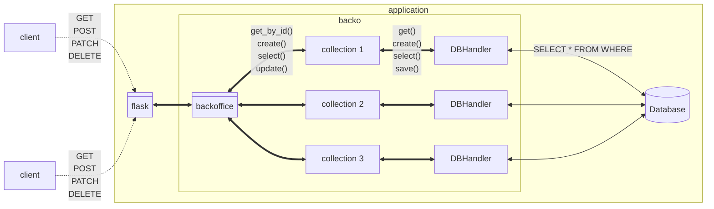
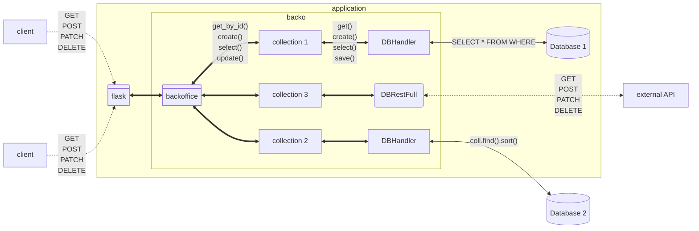

# Back Office Low Code (backo)


 

Jump to [Quickstart](https://backo.readthedocs.io/en/latest/Quickstart.html) for a basic setup.


See [Documentation](https://backo.readthedocs.io/en/latest/) for all details


## What is backo

It aims at providing a simple and efficient way to create a backend application that exposes a set of RESTfull API routes for [CRUD](https://en.wikipedia.org/wiki/Create,_read,_update_and_delete) and more.

It is based on :

* _Standard_ description of elements :
  * `Collection` (aka Table in SQL)
  * `Item` the object in the collection
  * `Ref`erences cross collections (_Ref_ and _RefsList_)
  * standard _types_ (Int, String, Dict, Float, Bool, List, Tuple)
  * custom types (inheritance)
  * files
  * standard attributes (required, default, ...)
* _Standard_ API 
  * All routes for CRUD
  * All routes for select (pagination, complex filtering)
* _Connector_ to a standard Database or file (MongoDB, Sqlite3, ...)


No dedicated language, no configuration file : __100% python__,  Full programatic (you can change _any_ value by a function with return a value, it is __YOUR__ code).

### Features

#### Full ORM in python

Backo is a [ORM](https://en.wikipedia.org/wiki/Object%E2%80%93relational_mapping) written in python.
It is Database agnostic.

Backo use [References to manage cardinalities](https://backo.readthedocs.io/en/latest/Cardinalities.html)

#### Api RestFull

Backo provide a complete [restfull API](https://en.wikipedia.org/wiki/REST) for CRUD, with data validation testing, security check, error management. 

It provides more routes than just CRUD :

* routes for checking,
* routes for mutipart (for file management)
* automatic [openapi 3.1](https://www.openapis.org/) structure

See [Routing](https://backo.readthedocs.io/en/latest/Routing.html) for details


#### Database handling

Backo can access to multiple database system (like SQlite3 or mongo). It can make cross references between different databases.

* Different types of databases (MongoDB, SQL, ...)
  * Filtering / sorting transformation into the DB language
* can adapt to existing database with `Transformer`
* can integration in an existing _SI_
  * mix different types of `DBHandler` per `Collection` with cross references
* Structure coherence policies
  * keep database coherence
  * delete item, _external collections_
  
See [Database handling](https://backo.readthedocs.io/en/latest/Database.html) for details


#### More than just schema

backo has an kind of extended schema description (like [pydantic](https://pydantic.dev/docs/validation/latest/get-started/)), but propose more features.

* Complex constraints
  You can have fields with contraint function. Example : the field `salary` must be above _10000_ if the field `job` is _doctor_

* Computational fields
  You can have fields that are the result of a python function. Example : the field `age` is a computation of another field (`date_of_birth`) and datetime.now()

* Conditional fields
  Every time, you have fields that exists only in some cases. Example : The field `thesis_defense_date` exists only if the field `job` is _doctor_

* File fields
  Files are managed like any other field. See [File documentation](https://backo.readthedocs.io/en/latest/File.html) for details.

* Events
  You can add events on fields. You can trigg a function when the field `address` has changed, when the object is deleted, loaded, ... or whatever


See [fields](https://backo.readthedocs.io/en/latest/Item.html#options) for details


#### Low code

The main idea is to reduce the code you write, and focus on the _business code_.

| feature | backo | you | comment |
| -- | -- | -- | -- |
| Input Validation Testing | :white_check_mark: | | |
| Schema Validation Testing | :white_check_mark: | | |
| Security check | :white_check_mark: | | |
| Database consistency | :white_check_mark: | | different [policies](https://backo.readthedocs.io/en/latest/Cardinalities.html#api-reference) |
| Web server and API Restfull | :white_check_mark: | | Done with [Flask](https://flask.palletsprojects.com/en/stable/) |
| Authentication | :heavy_check_mark: | :white_check_mark: | Code the auth, and give a JWT to backo |
| RBAC | :white_check_mark: | :white_check_mark: |  _business code_ : You just have to describe what you want (in python) |
| Security everywhere | :white_check_mark: | :white_check_mark: | _business code_ : You can add rights on every objects, field... |
| Database(s) |  :white_check_mark: | :rocket: | you can use mutiple databases and adapt to existing databases, with cross-references |
| Files |  :white_check_mark: | | files are just fields like others |
| Compute a field | :white_check_mark: | :rocket: | you can add fields with are the result of a python function, and depend on other fields. Just write the function |
| Conditional fields | :white_check_mark: | :rocket: | you can have fields depending on others |
| Events | :white_check_mark: | :rocket: | every field can trigg and react on events |
| openapi | :white_check_mark: | | The [openapi 3.1 doc](https://www.openapis.org/) is generated from your code |

### Short example

Here is a small example to see what looks like a backo code for one Collection.

See [Coding](https://backo.readthedocs.io/en/latest/Quickstart.html#coding.html) to understand quickly how it works.


```python
from Flast import flask
from backo import Backoffice, Collection, Item, String, Int, Dict, Ref, Datetime
from backo.file import File, FileSystemConnector
from backo.db import DBMongoConnector

# Define the Item
books_item = Item(
    {
        "title": String(require=True, default="No title", can_modify=modify_books_title_function),
        'cover': File( require=True, mime_types=[ 'image/jpeg', 'image/png' ], work=FileSystemConnector( path="/path/to/store/the/file" ) ),
        "pages": Int(),
        "borrow": Dict(
            {
                "user": Ref(
                    coll="users",
                    field="$.rent.books",
                ),
                "return_date": Datetime(),
                "date": Datetime(),
            },
        ),
    }
)
# define the DBHandler
connector = DBMongoConnector(
    connection_string="mongodb://...", collection="Books"
)
# define the Collection
books = Collection("books", books_item, connector)
myapp = Backoffice("media_library") # my backo
myapp.register_collection(books)

# set up the serveur
flask = Flask("my_media_library")
myapp.build_routes(flask) # build API routes
flask.run(host="0.0.0.0", port=5000) # start the web server
```

See [the full example](https://github.com/backo-stricto/backo/tree/main/examples/media_library)


## Architecture

### A single application


Scheme of a classical architecture (mono database), with `Collections` (aka `Tables`) all in the same DB.



### Integration


Scheme of an architecture with `Collections` (aka `Tables`) dispatched in differents DB (not because you want to do that, but because databases already exists like that)




## Documentation and examples

We try to maintain a [full comprehensive documentation](https://backo.readthedocs.io/en/latest)

And some runnable examples [runnable examples](https://github.com/backo-stricto/backo/tree/main/examples)


## About us

backo is developped and maintained by [the engineers team](https://sed-nge.inria.fr/) of [inria](https://inria.fr/en) (especially [Centre inria de l'Universite de Lorraine](https://inria.fr/fr/centre-inria-universite-lorraine))

(Sorry some links are in french...)

## Disclaimer

We want backo as :

* [FOSS](https://en.wikipedia.org/wiki/Free_and_open-source_software), event if some binding to non free databases ([mongoDB](https://www.mongodb.com)...)
* under MIT Licence, 
* without the minimum dependency from other packages. A light package.
* __without vibe coding__ : You can use IA for helping you, but without embedded agent in your IDE. And your prompt must start with "Explain me how ...". **The IA must enhance your knowledge !**

Don't hesitate to [contact us](https://github.com/backo-stricto/stricto/discussions) and [contribute](https://github.com/backo-stricto/stricto/blob/main/CONTRIBUTING.md)


## Tests & co

For personal use only.

Legacy virtualenv workflow:

```bash
# all tests
python -m unittest tests
# or for a specific test
python -m unittest tests.TestDict.test_simple_type

# reformat
python -m black .

# pylint
pylint $(git ls-files '*.py')

# coverage
coverage run -m unittest tests
coverage html # report under htmlcov/index.html
firefox htmlcov/index.html

# docs
uv sync --all-extras --all-groups
cd docs
uv run make html

```


uv workflow:

```bash
uv sync --all-groups --all-extras

# all tests
uv run python -m unittest tests
# or for only some tests
uv run python -m unittest tests/test_bool.py
# or for a specific test
uv run python -m unittest tests.TestDict.test_simple_type

# reformat
uv run black .

# pylint
uv run pylint $(git ls-files '*.py')

# coverage
# for all tests
uv run coverage run -m unittest tests
# for a single tests suite
uv run coverage run -m unittest tests.MyTests
uv run coverage html # report under htmlcov/index.html
firefox htmlcov/index.html
```


### Building a new release

For personal use only.

```bash
# Modify changelog
# modify pyproject.toml
git add -u
git commit -am 'preparing 0.0.x'
git push
git tag -a 0.0.x -m '0.0.x'
git push origin tag 0.0.x

# publish a new relase in github interface, based on tag 
```
