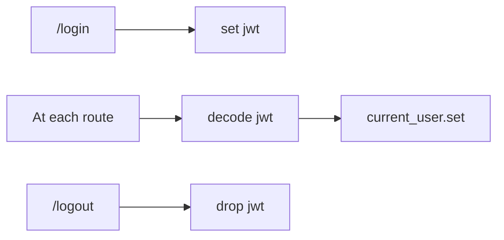

# Authentication and rights

This part is about authentication and RBAC.

(Authentication)=
## Authentication

### General

Authentication is not managed by backo. This is a choice because there is so much way to authenticate a person or an app that it is unable to code all of them into backo.
backo juste care about a ```JWT token``` or anything you provides to fill {ref}`current_user`

Authentication is your side and you have to provide :

1. One or more authentication methode which set a ```JWT token```
2. A *verify function* which read the ```JWT token``` and populate the {ref}`current_user`.




```{caution}
The *verify function* must be passed as args to .build_routes() call
```

### Example

This is an short and uncompleted example to authenticate and fill {ref}`current_user`.

First, the connection part. a `/login` route allows the login and returns a JWT. The second part : The decorator used to authenticate the route and to populate {ref}`current_user`


`````{tab-set}
````{tab-item} authenticate and fill JWT
```python
app = Flask(__name__)
app.secret_key = "super secret key"
# Set the login route
@app.route("/login", methods=["POST"])
def login():
    """
    login load the user from the DB, verify the password and if
    Ok generate a JWT an return it to the client.
    At this point, current_user is not used.
    """
    d = request.json
    login = d["login"]
    password = d["password"]
    # find the user by your way and check its password
    authenticated = True # for the example
    if not authenticated:
      return jsonify({"message": "Invalid email or password"}), 401
 
    token = jwt.encode(
        {
            "exp": datetime.now(timezone.utc) + timedelta(hours=1),
            "user_id": user._id ,
        },
        "myappsecretkey",
        algorithm="HS256",
    )
    response = make_response(json.dumps({"login": "ok"}))
    response.set_cookie("jwt_token", token)
    return response
```

````
````{tab-item} verification function

```python
def token_required(f):
    @wraps(f)
    def decorated(*args, **kwargs):
        token = request.cookies.get("jwt_token")
        if not token:
            return jsonify({"message": "Token is missing!"}), 401
        try:
            data = jwt.decode(token, "myappsecretkey", algorithms=["HS256"])
        except:  # pylint: disable=bare-except
            return jsonify({"message": "Token is invalid!"}), 401

        # Load the user from the DB and fill current_user
        # we supose roles are store in your user_db
        user = load_from_db_by_id( data["user_id"] )
        current_user.set( { "_id" : user._id, "login" : user.login, "roles" : user.roles })

        return f(*args, **kwargs)
    return decorated
```
````
`````

Then pass the function as args when you build routes.

```python
myapp.build_routes(flask, "", check_user_token)
```


(current_user)=
## current_user

`current_user` represents the currently loggued user.

### usage

```python
# anywhere in your code
from backo import current_user

print(current_user._id) # The id of the current connected user
print(current_user.login) # A login name or whatever you store as "login"

# check if the user has the given role
if current_user.has_role('teamManager'):
  return True
```

### How to set values to the current_user ?

`backo` doesnt manage authentication, because there is so much way to authenticate a user (or an app). So you have to do the auth by yourself.

However, using jwt is a goot solution. See {ref}`Authentication` for that.


### current_user API

`current_user` is a very simple [Stricto Dict](https://stricto.readthedocs.io/en/latest/api_reference.html#stricto.Dict) (but can be {ref}`extended <extend_current_user>`). It contains :

| key | type | usage |
| - | - | - |
| _id | [Stricto String()](https://github.com/backo-stricto/stricto?tab=readme-ov-file#string) | the _id of the user. 
| login | [Stricto String()](https://github.com/backo-stricto/stricto?tab=readme-ov-file#string) | the login or whatever you store . 
| roles | [Stricto List( String() )](https://github.com/backo-stricto/stricto?tab=readme-ov-file#list) | the list of roles for this users. A *role* is a kid of group the user belongs to | 
| has_role() | function | return True or false to the role givent in param | 
| reset() | function | change the current_user object type. See {ref}`extended <extend_current_user>` for that| 

(extend_current_user)=
### extend current_user

You can extend `current_user`, adding stuff in its schema, functions... etc.


```python
from backo import current_user, CurrentUser, CurrentUserWrapper

class MyCurrentUser(CurrentUser):


      def __init__(self, obj: CurrentUser):

        CurrentUser.__init__(self, obj)
        self.add_to_model( 'email' , String() )


    """
    a new class child of CuurrentUser
    """
    def my_function(self):
        """
        a Dummy function
        """
        return(f"user {self.login} ({self._id})")

current_user.reset(MyCurrentUser())

# Later in the code
current_user.email = "toto@titi.com"
current_user.my_function() # return the string "user ..."
```


## Rights


A right (or RBAC) is a function (or a lambda) with thoses parameters, and must return a boolean.


```python
def your_function_name(right_name: str, o: Item) -> bool:

```

```{tip}
Rights are based on {ref}`current_user` which contains information about the currently connected user.
```


### Rights for Items and fields


| right      | description                                              |
| ---------- | -------------------------------------------------------- |
| can_read   | Check if {ref}`current_user` can read the field                      |
| can_modify | Check if {ref}`current_user` can modify the field |

### Rights for collection


| right      | description                                              |
| ---------- | -------------------------------------------------------- |
| can_create | Check if {ref}`current_user` can create Items in the collection     |
| can_read   | Check if {ref}`current_user` can read Items of this collection                      |
| can_modify | Check if {ref}`current_user` can modified Items of this collection|
| can_delete | Check if {ref}`current_user` can delete items in the collection  |


### Rights for actions


| right       | description                                                   |
| ----------- | ------------------------------------------------------------- |
| can_execute | Check if {ref}`current_user` can execute the action |


### rights for selections


| right    | description                                                 |
| -------- | ----------------------------------------------------------- |
| can_read | Check if {ref}`current_user` can do the selection |


## API Reference

See {py:class}`current_user <backo.current_user>` 