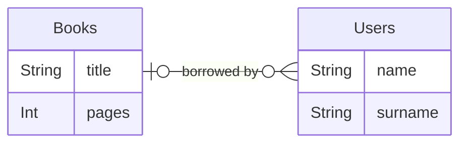

# References and cardinalities


Imagine this Entity Relationship : A book can be borrowed by zero or one user, but a user can borrow zero or more books.



You only will use {ref}`Ref` and {ref}`RefsList` to exprime the relationship. It translates into Python code using Backo like following:


`````{tab-set}
````{tab-item} books
```python
from backo import (
    String,
    Int,
    Dict,
    Collection,
    Item,
    Ref,
)
from backo.db import DBMongoConnector

books_item = Item(
    {
        "title": String(require=True, default=""),
        "pages": Int(),
        "borrowed": Bool(set=set_borrowed, views=["save"]),
        "borrow": Dict(
            {
                "user": Ref(
                    coll="users",
                    field="$.rent.books",
                    can_read=can_read_borrow_user,
                ),
                "return_date": Datetime(),
                "date": Datetime(),
            },
        ),
    }
)

connector = DBMongoConnector("mongodb://localhost:27017/media_library", "Books")

books = Collection(
    "books",
    books_item,
    connector,
)
```
````
````{tab-item} users
```python

from backo import (
    String,
    List,
    Dict,
    Collection,
    Item,
    RefsList,
)
from backo.db import DBMongoConnector


# The item is the object in the collection
user = Item(
    {
        "login": String(require=True, can_modify=can_modify_login, default=""),
        "email": String(),
        "roles": List(
            String(union=["ADMIN", "EMPLOYEE", "USER"], default="USER"),
            can_modify=can_modify_roles,
        ),
        "rent": Dict({"books": RefsList(coll="books", field="$.borrow.user")}),
    }
)

connector = DBMongoConnector(
    connection_string="mongodb://localhost:27017/media_library", collection="Users"
)


users = Collection(
    "users",
    user,
    connector,
)
```
````
````{tab-item} backoffice

```python
from .books import books
from .users import users

my_backoffice.register_collection(books)
my_backoffice.register_collection(users)

# Your flask application
flask = Flask(__name__)

# -- Add CRUD routes for this application
my_backoffice.build_routes(flask)

```
````
`````


Relations between `Collections` are expressed by the mean of {py:class}`Ref() <backo.Ref>` and {py:class}`RefsList() <backo.RefsList>`:


* `Ref()`: for `0 or 1` or `exactly 1` relations.
* `RefsList()`: for `0 or more` or `1 or more` relations.


| Item A                       | Item B              | description      |
| ---------------------------- | ------------------- | ---------------- |
| `Ref`               | `Ref`      | 0 or One to one  |
| `Ref`               | `RefsList` | 0 or One to many |
| `Ref(require=True)` | `RefsList` | One to many      |
| `RefsList`          | `RefsList` | Many to many     |


(ref)=
## Ref

A {py:class}`Ref() <backo.Ref>` match the Item in the targeted collection. 
For its definition, a Ref must have :

| Option for Ref | Default | Description |
| - | - | - |
| `coll=` | None | the collection to make the ref |
| `field=` | None | The reverse field in the targeted collection (use [selectors](https://stricto.readthedocs.io/en/latest/readme.html#selectors) to target it) (optional) |


```{tip}
It will be translated into a string with the `_id` of the matched object.
```


(refslist)=
## RefsList

A {py:class}`RefsList() <backo.RefsList>` references zero or many items into the targeted collection.


| Option for RefsList | Default | Description |
| - | - | - |
| `coll=` | None | the collection to make the ref |
| `field=` | None | The reverse field in the targeted collection (use [selectors](https://stricto.readthedocs.io/en/latest/readme.html#selectors) to target it) |
| `ods=` | ```DeleteStrategy.MUST_BE_EMPTY``` | see {ref}`On Delete Strategy <ods>`|
| `ofs=` | ```FillStrategy.FILL``` | see {ref}`On Fill Strategy <ofs>` |

And all options availables in [stricto String()](https://github.com/backo-stricto/stricto?tab=readme-ov-file#string) fields.


```{tip}
RefsList will be translated into a list of strings with the `_id` of the matched object if ```FillStrategy.FILL```.
```


(ofs)=
### Fill strategies (`ofs`)

* `ofs=` On Fill Strategy : fill the value ?
  * ```FillStrategy.FILL``` (by default) fill it
  * ```FillStrategy.NOT_FILL``` just keep ref

(ods)=
### Deletion strategies (`ods`)

ods define the behaviour of the database when a delete occure and the object contain some `RefList`. For each  `RefList`, you can define the strategy :

* ```DeleteStrategy.MUST_BE_EMPTY``` (by default)
Requires the RefList to be empty before allowing the object to be deleted.
If the RefList contains items, the deletion will be blocked and an error will be raised.

* ```DeleteStrategy.DELETE_REFERENCED_ITEMS```
When deleting the parent object, this strategy also deletes all objects referenced in the RefList.
[!Warning] Use with caution, as this causes cascading deletes and may remove many related objects unintentionally.

* ```DeleteStrategy.UNLINK_REFERENCED_ITEMS```
Instead of deleting the referenced objects, this strategy removes the reference to the deleted object from each referenced item.
This is commonly used for many-to-many relationships where you want to delete the parent object but keep the referenced objects intact, but simply cleaning up their links.


## API Reference

See {py:class}`Ref() <backo.Ref>` and {py:class}`RefsList() <backo.RefsList>` 