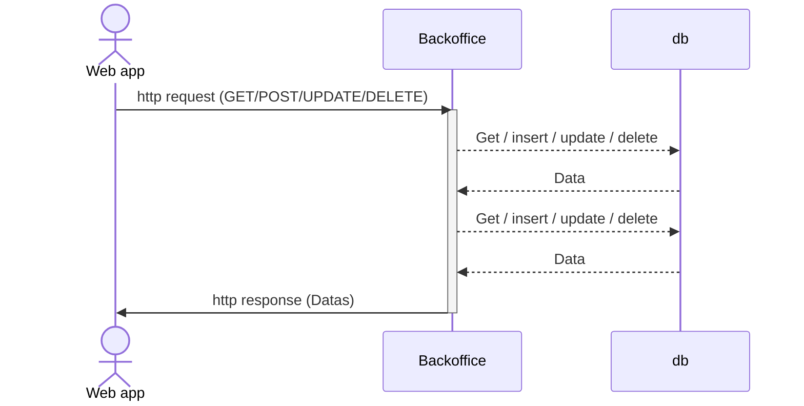
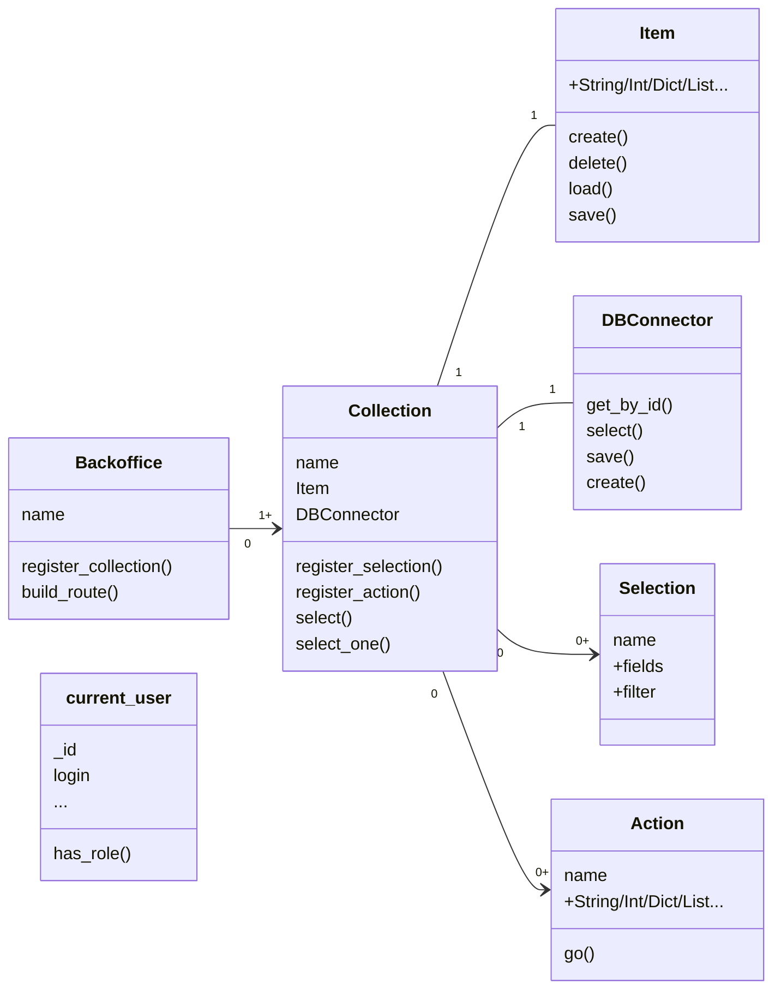

# Coding in backo

## How it works

backo is designed to :

* Avoid coding 
  * Sanity check (this field must be a positive integer, i must verify it everywhere without missing one occurence)
  * Security check (this user has the hability to modify this field ? I must check it everywhere without missing one occurence)
  * Database management, SQL (or whatever) filters.
  * Error management (oh yes, fed up with _try catch_).
  * {doc}`Cardinalities` managements in the DB (managing SQL join tables is a mess).
  * Integration with existing datas ( the books table already exists... you should connect to this api...)
  
* Do a maximum of the business code on the server side. By this way, you will reduce the client side business code. 
* Reduce the client side verification code (see {ref}`Validation route <validation_routes>` for example)
* Permit complex modification in one rest api call (see {doc}`Action`)
* Permit complex selection in one rest api call (see {doc}`Selection`)


## Rules

### Everything are function. 
  * When you want to describe a right, you will write a small function (with must return a boolean).
  * When you want to describe a complex constraint on a field for example (more than just "must be required"), you will write a small function whith do that.
  * and so on...

```{important}
Any value can be a function with return the corresponding value
```

```{tip}
a backend with backo will be a lot of function. Pleast take care about function names and their storage.
```

### Everything is checked at any time

if an Item has a a constraint like _user_ is an {doc}`Item`. its field _name_ is a String

The following code anywhere will produce an error. The error will be catched up and sent to the client in the restfull API.

```python
x = 13
user.name = x # -> will raise an error
user.name.set(x) # -> will raise an error
user.set({ 'name' : x }) # -> will raise an error
```

```{important}
You don't have to check things, for types, constraints, rights, ... backo will do for you.
```

### No business code in the client

If you code some business logic manipulation in the client (not just UI/UX), you probably can do that in an {doc}`Action`.

### Do not compute anything on the client

If you want to compute some value in the client from the DB, please take a look at {ref}`computation` for computing a field in the server side and just display it on the client side.


### Ignore Relationship consistency

Ignore Relationship consistency. backo will do it for you, and will do some rollback in case of errors.

See {doc}`Cardinalities` for details.

To exprime the relationship, use {ref}`Ref` and {ref}`RefsList` fields directly in {doc}`Item` description, like other fields.

### Selectors everywhere

Json selectors are used to find the field in the {doc}`Item`. See[rfc9535](https://datatracker.ietf.org/doc/rfc9535/)
The are used every where

smart examples :
```python

user.name # -> the name of the user 
user.select("$.name") # -> The same

# Follow Ref or RefsList
user.rent.books # -> A list of book _id, for example [ "1234", "4242" ]
user.select("$.rent.books") # -> [ "1234", "4242" ]
user.select("$.rent.books.") # -> A list of book Items (yes backo will do the select for you)
user.select("$.rent.books.title") # -> A list of string (the book title)
user.select("$.rent.books[0].title") # -> "A book title"

```

## Sequence diagram

Backo is a middle ware beetween client (web client) and databases.
basically, it answer to client request, process jobs or whatever, and return datas.




## Class diagram

This is the main class diagram to unrdestand backo.
Each object are described in documentation. if you use backo. please pin this diagram on the wall ;)



## Crossover objects

Il the code, at every time, you can get other objects.

### From Item

```python
# book is an Item
book._collection # -> the collection
book._collection.backoffice # -> the backoffice
book._collection.get_other_collection("users") # -> The collection users

book._collection.backoffice.collections["users"] # -> The collection users
```

### From a field

```python
# book is an Item
name = book.name  # -> the "name" field
name = book.select("$.name")  # -> similar

name.get_root() # -> book Item

```

### Follow Refs and RefsList

You can follow  {ref}`Ref` and {ref}`RefsList` fields directly in {doc}`Item` without doing any select.

```python
# user is an Item

# Follow Ref or RefsList
user.rent.books # -> A list of book _id, for example [ "1234", "4242" ]
user.select("$.rent.books") # -> [ "1234", "4242" ]
user.select("$.rent.books.") # -> A list of book Items (yes backo will do the select for you)
user.select("$.rent.books.title") # -> A list of string (the book title)
user.select("$.rent.books[0].title") # -> "A book title"

# go deeper
user.select("$.rent.books[0].borrow.user.name") #-> return user.name 

```

### From a collection

```python
# book is an Item
books = book._collection  # -> the books collection

new_book = book.create({ ... }) # -> Create a new Item 

my_act = books._actions["my_action"] # -> get the Action
my_select = books._selections["my_selection"] # -> get the Selection

```


### From an Action

```python
# book is an Item
books = book._collection  # -> the books collection
my_act = books._actions["my_action"] # -> get the Action

my_act.backoffice # -> the backoffice
my_act.collection # -> books

```

### From a Selection

```python
# book is an Item
books = book._collection  # -> the books collection
my_select = books._selections["my_selection"] # -> get the Selection

my_select.backoffice # -> the backoffice
my_select.collection # -> books

```

### get current_user


howto get current_user

```python
from backo import current_user

# that's all
```


## API Reference

See {ref}`api_references`